# Informe de Ejercicios: Laboratorio 5.1

## Laboratorio 5.1: Creación de un Workflow de GitHub Actions para CI

---

# Portada

UNIVERSIDAD MAYOR, REAL Y PONTIFICIA DE SAN FRANCISCO XAVIER DE CHUQUISACA

FACULTAD DE CIENCIAS Y TECNOLOGÍA

**Nombre:** VALDA PLAZA CAMILA MONSERRAT

**Carrera:** INGENIERÍA DE SISTEMAS

**Asignatura:** Trabajando en la Nube (COM610)

**Docente:** Ing. Marcelo Quispe Ortega

**Semestre:** 2/2026

SUCRE – BOLIVIA

---

# Introducción

En este laboratorio se construyó, paso a paso, un flujo de integración continua (CI) con GitHub Actions sobre una aplicación sencilla de Node.js y Express. El objetivo fue entender cómo un **pipeline** automatiza una secuencia de tareas cada vez que se sube código al repositorio: descargar el código, preparar el entorno, instalar dependencias, revisar el estilo con ESLint y ejecutar las pruebas.

Un pipeline es, en términos simples, una cadena ordenada de pasos automáticos. Si un paso falla, la ejecución se detiene y el resultado queda marcado como fallido, lo que permite detectar errores antes de integrar cambios a la rama principal. En este laboratorio el pipeline se fue ampliando: primero solo ejecutaba pruebas, después incorporó el linting y finalmente se ejecutó en paralelo con una matriz de versiones de Node.js.

El repositorio utilizado fue `github-actions-ci-demo`. La aplicación expone dos rutas (`/health` y `/users`), las pruebas se escribieron con Jest y Supertest, y el análisis estático se realizó con ESLint.

**Nota sobre las capturas:** la numeración corresponde a los archivos originales del repositorio. La secuencia omite las imágenes 40 y 46, y algunas capturas se tomaron en momentos distintos, por lo que el orden de los archivos no siempre coincide exactamente con el orden cronológico de los hechos.

Este informe corresponde únicamente a los ejercicios 3.1 a 3.4 del laboratorio. La práctica individual, con la API de inventario, se documenta por separado en <https://github.com/CamilaMonserratValdaPlaza26/inventario-ci>.

---

# Ejercicio 3.1: Preparación del repositorio y la aplicación

**Objetivo:** crear el repositorio `github-actions-ci-demo`, clonarlo, inicializar un proyecto Node.js con Express y agregar pruebas unitarias con Jest y Supertest.

Las imágenes de este ejercicio son la 1 a la 12.

## Desarrollo

**Figura 1. Creación del repositorio en GitHub.**
Se observa el formulario de creación de un repositorio nuevo. El propietario es `CamilaMonserratValdaPlaza26`, el nombre es `github-actions-ci-demo`, la descripción es «GitHub Actions CI Demo» y la visibilidad seleccionada es pública. También están activadas las opciones para agregar un README y un `.gitignore` de Node, sin licencia, y el botón verde para confirmar la creación.

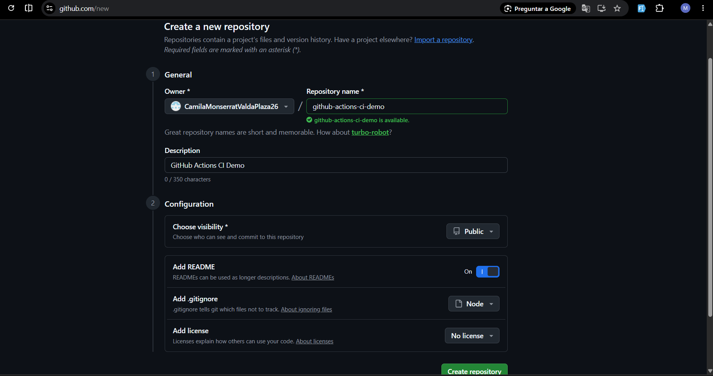

**Figura 2. Repositorio creado.**
Se observa la página principal del repositorio ya creado, con la rama `main`, una rama y cero etiquetas. Aparecen los archivos `.gitignore` y `README.md`, el commit inicial `829b1ad` con el mensaje «Confirmación inicial», la descripción del repositorio y el botón `Código` para copiar la URL de clonación.

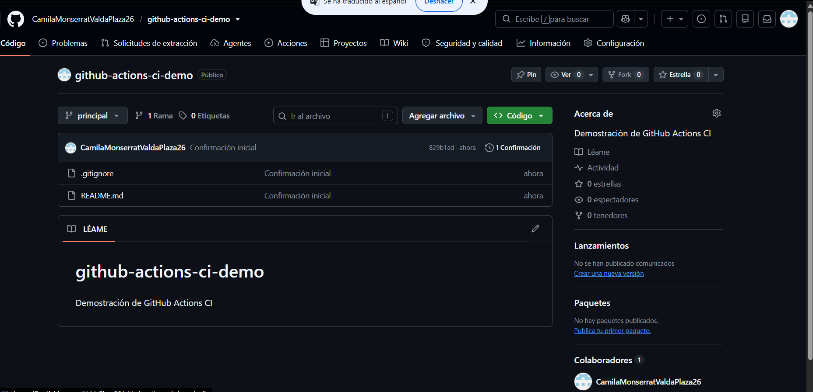

**Figura 3. Clonación del repositorio.**
Se observa una terminal de Windows PowerShell ejecutando `git clone` sobre la URL del repositorio. El comando enumera cuatro objetos, descarga el contenido y deja la carpeta `github-actions-ci-demo` creada; después se cambia de directorio con `cd` para trabajar dentro del proyecto.

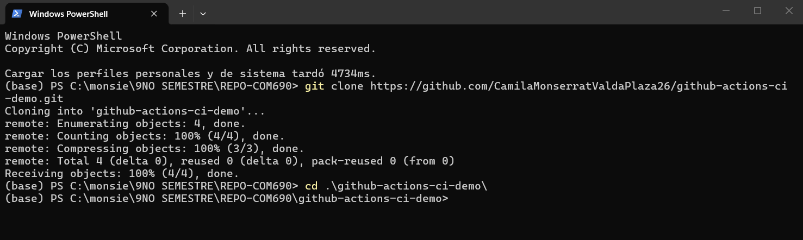

**Figura 4. Configuración local de Git y estado del repositorio.**
Se observa la terminal con `ls`, que muestra la carpeta `img/` y el archivo `README.md`, y con `git config --global --list`, que confirma el correo `caminashi11@gmail.com`, el nombre `monsievalda`, `core.longpaths` y `core.editor`. También se ejecuta `git config core.autocrlf true` y `git status`, que indica que la rama `main` está actualizada y que `img/` todavía no tiene seguimiento.

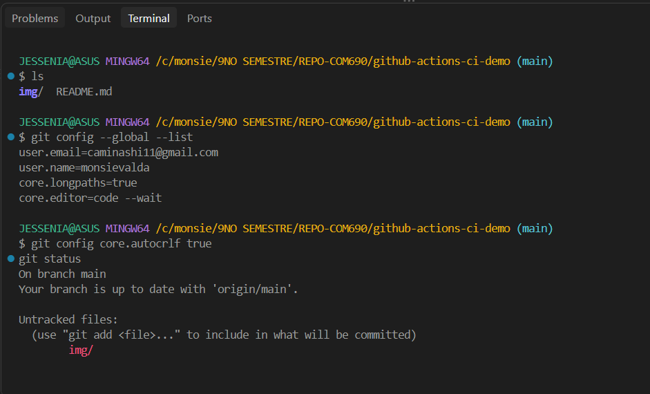

**Figura 5. Inicialización del proyecto Node.js.**
Se observa la ejecución de `npm init -y`, que genera el archivo `package.json`. El contenido muestra el nombre `github-actions-ci-demo`, la versión `1.0.0`, la descripción, el archivo principal `index.js`, el script de prueba provisional y la URL del repositorio; este archivo se abrirá después en VS Code.

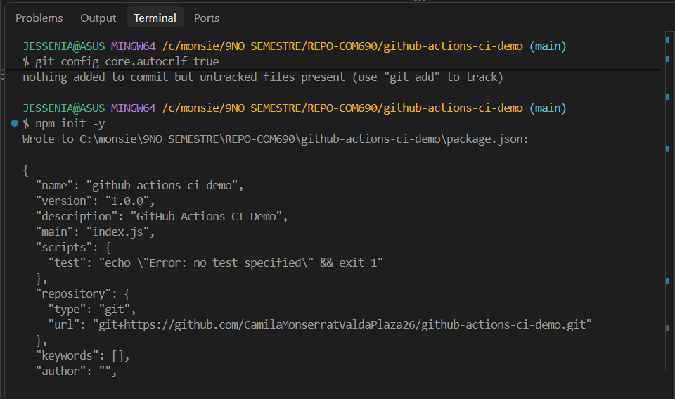

**Figura 6. Instalación de Express, Jest y Supertest.**
Se observa la instalación de dependencias: primero `npm install express`, que agrega 65 paquetes sin vulnerabilidades, y después `npm install --save-dev jest supertest`, que agrega 296 paquetes y reporta 19 vulnerabilidades. En el explorador de VS Code aparecen `node_modules`, `package-lock.json`, `package.json` y las imágenes `img/1.png` a `img/5.png` sin seguimiento.

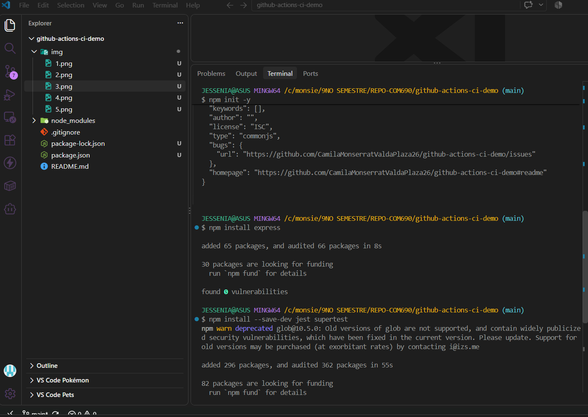

**Figura 7. Resultado de la instalación de dependencias.**
Se observa el final de la salida de `npm install --save-dev jest supertest`, con el aviso de que 19 paquetes presentan vulnerabilidades (1 baja y 18 moderadas) y la sugerencia de ejecutar `npm audit fix`. La terminal queda lista para continuar con la creación de los archivos de la aplicación.

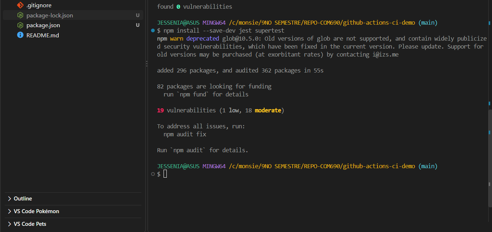

**Figura 8. Código de la aplicación Express.**
Se observa el archivo `app.js` con la importación de Express, la creación de `app` y el middleware `express.json()`. La ruta `GET /health` responde `{ status: 'ok' }`, la ruta `GET /users` devuelve dos usuarios de ejemplo y al final se exporta `app` para que `server.js` y las pruebas puedan usarlo.

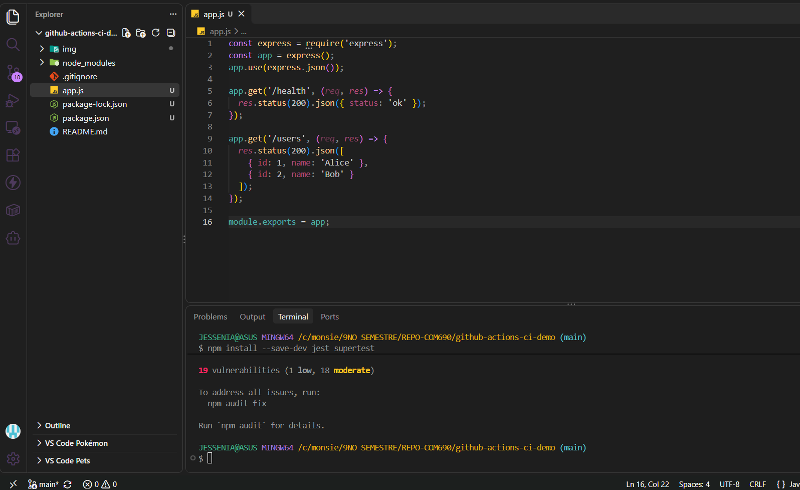

**Figura 9. Archivo server.js.**
Se observa el archivo `server.js`, que importa `app`, define el puerto con `process.env.PORT || 3000` y llama a `app.listen`. Cuando el servidor arranca, imprime en consola el mensaje «Servidor escuchando en el puerto 3000»; este archivo es el punto de entrada de la aplicación.

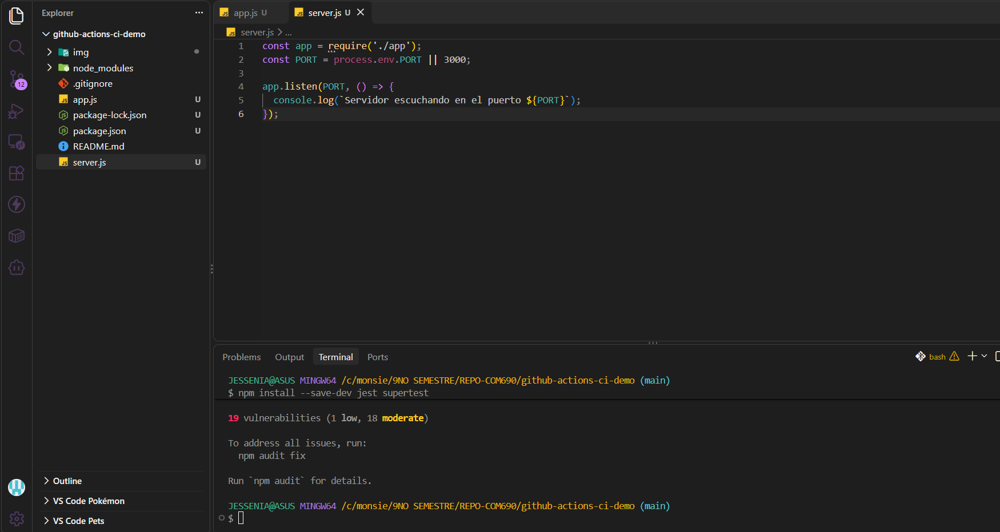

**Figura 10. Archivo de pruebas app.test.js.**
Se observa el archivo `app.test.js`, que importa Supertest y `app`. La primera prueba verifica que `GET /health` responda 200 con `status` igual a `ok`; la segunda verifica que `GET /users` responda 200, devuelva un arreglo y tenga dos elementos. Ambas pruebas usan `async/await` y las aserciones de Jest.

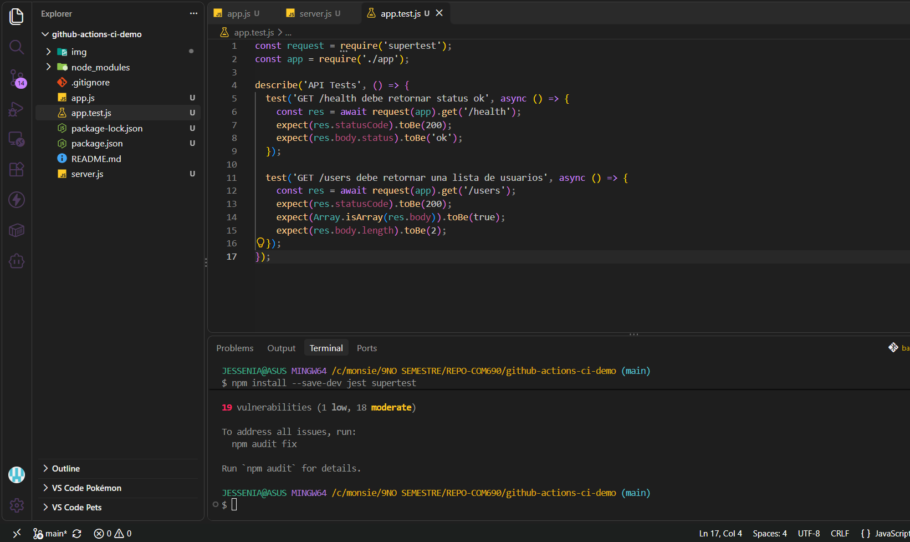

**Figura 11. Verificación de versiones instaladas.**
Se observa la terminal ejecutando `npm view` para consultar las versiones disponibles de Express, Jest y Supertest. Los resultados son `5.3.0`, `30.5.2` y `7.3.2`, respectivamente, lo que confirma las versiones con las que se trabajó antes de crear el workflow.

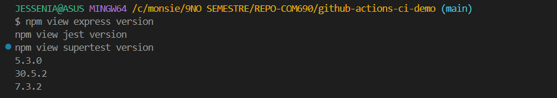

**Figura 12. Scripts y ejecución local de las pruebas.**
Se observa el `package.json` con los scripts `start` (`node server.js`) y `test` (`jest`), y la terminal ejecutando `npm test`. Jest muestra `PASS ./app.test.js`, las dos pruebas aprobadas, una suite aprobada y un tiempo de 2.323 segundos, por lo que la aplicación funciona antes de subirla.

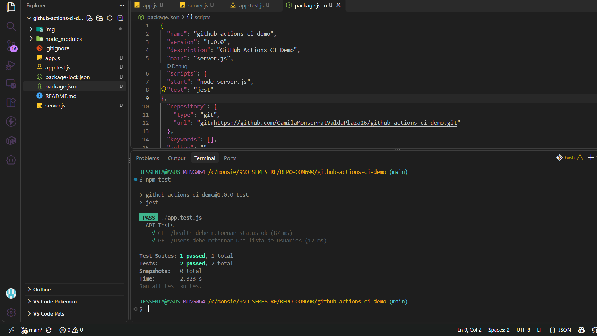

---

# Ejercicio 3.2: Creación del workflow de CI

**Objetivo:** crear el archivo `.github/workflows/ci.yml` y verificar que el workflow se ejecute automáticamente en la pestaña Actions.

Las imágenes de este ejercicio son la 13 a la 30.

## Desarrollo

**Figura 13. Contenido del archivo .gitignore (parte 1).**
Se observa una sección del archivo `.gitignore` con reglas para el historial de REPL, los paquetes generados por `npm pack`, el archivo de integridad de Yarn y los archivos de variables de entorno. Estas reglas evitan subir archivos temporales o con datos sensibles al repositorio.

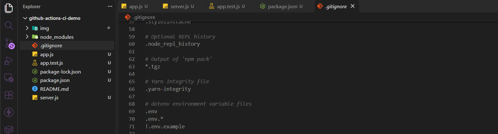

**Figura 14. Contenido del archivo .gitignore (parte 2).**
Se observa otra sección del `.gitignore` con la configuración de `node-waf`, los binarios compilados, los directorios de dependencias `node_modules/` y `jspm_packages/`, el directorio de Snowpack y la caché de TypeScript. La regla más importante es `node_modules/`, porque las dependencias se reinstalan con `npm ci` en el runner.

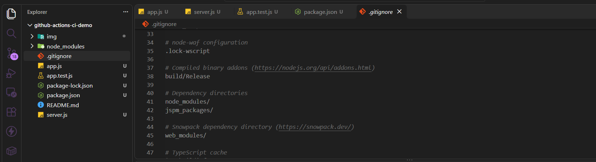

**Figura 15. Primer commit de la aplicación.**
Se observa la terminal ejecutando `git add .`, con avisos de conversión de fin de línea, y `git commit -m "feat: inicializa aplicacion express con pruebas unitarias"`. El commit `e0ac533` registra 20 archivos y 5739 inserciones, entre ellos `app.js`, `app.test.js`, las imágenes, `package-lock.json`, `package.json` y `server.js`.

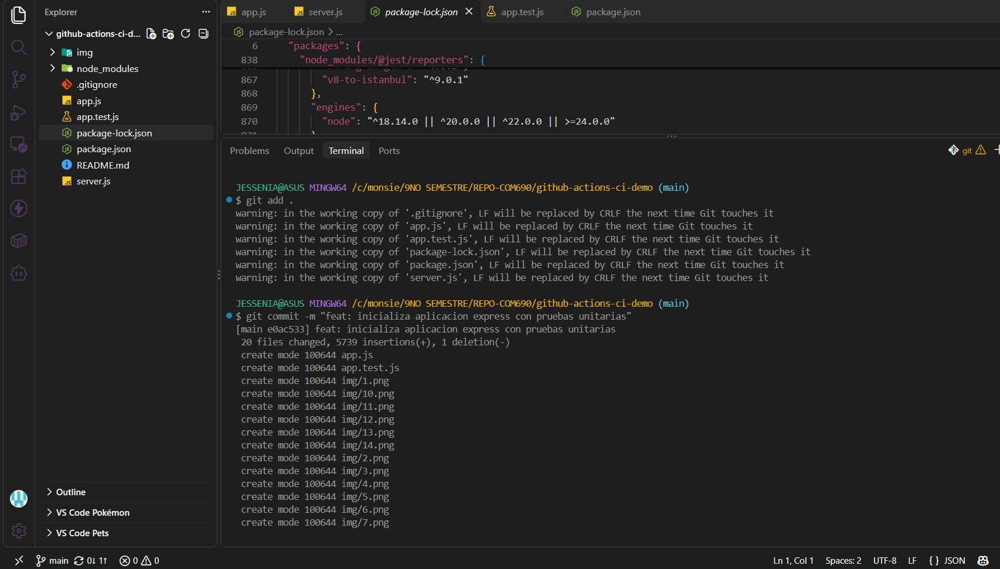

**Figura 16. Push del commit inicial.**
Se observa el final del commit anterior y la ejecución de `git push origin main`, que sube los cambios desde `829b1ad` hasta `e0ac533`. La terminal confirma la escritura de los objetos y deja la rama `main` sincronizada con el repositorio remoto.

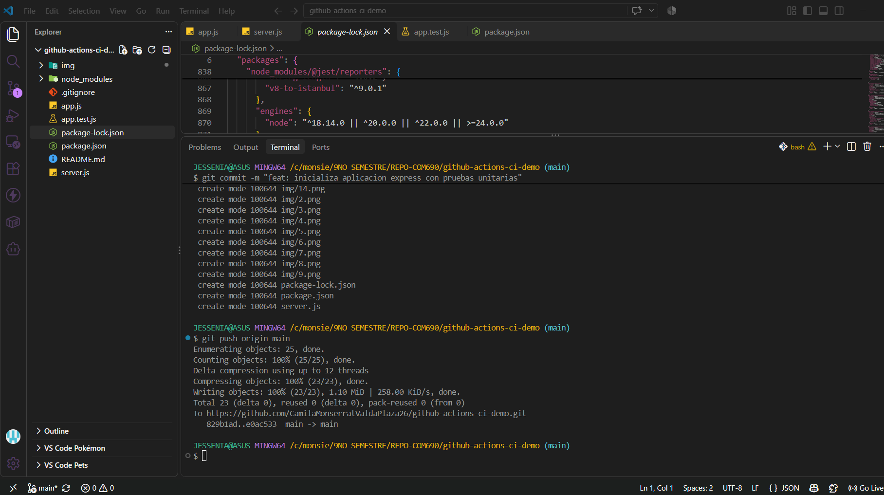

**Figura 17. Repositorio con la aplicación subida.**
Se observa la página del repositorio en GitHub con la carpeta `img`, el `.gitignore`, el `README.md`, `app.js`, `app.test.js`, `package-lock.json`, `package.json` y `server.js`. El último commit es `e0ac533` con el mensaje «feat: inicializa aplicacion express con prueba...», lo que confirma que la aplicación y las pruebas ya están en el remoto.

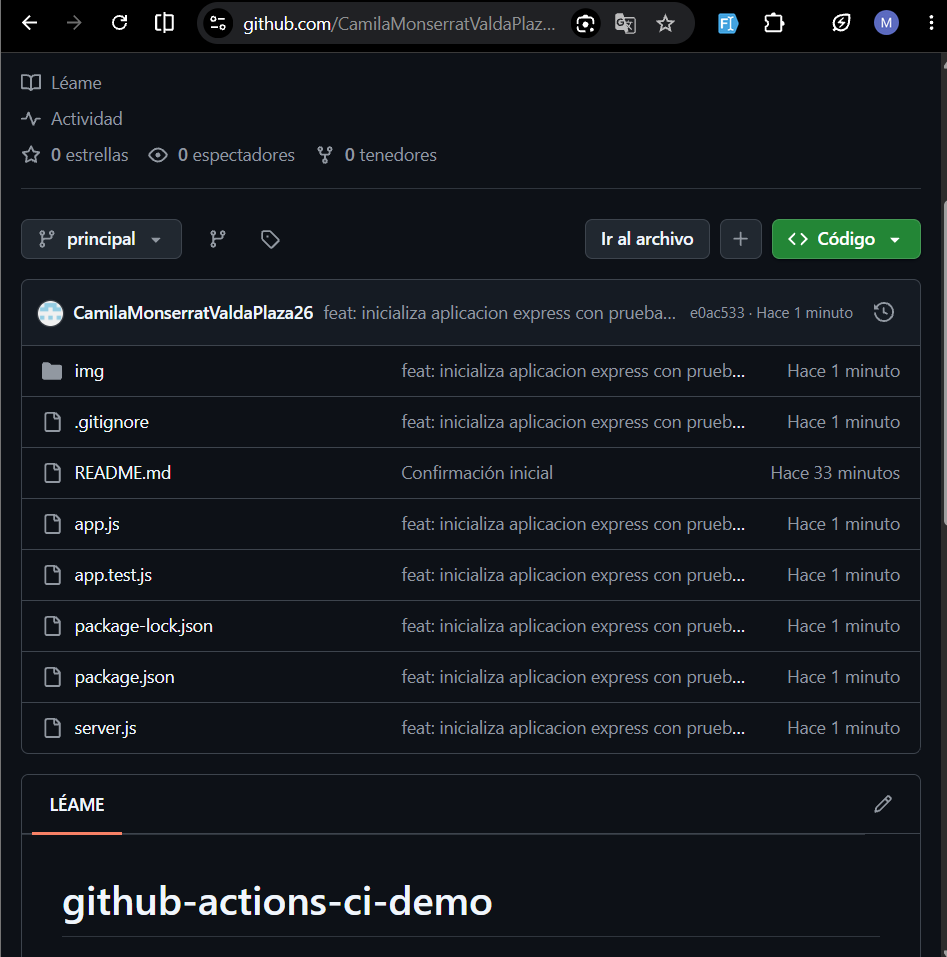

**Figura 18. Preparación de la carpeta del workflow.**
Se observa la terminal con el final del commit y del push, seguida de `mkdir -p .github/workflows` y `touch .github/workflows/ci.yml`. El comando `ls -a` muestra la nueva carpeta `.github` junto con `.git`, `.gitignore`, `app.js`, `app.test.js`, `img`, `node_modules`, `package.json`, `package-lock.json`, `README.md` y `server.js`.

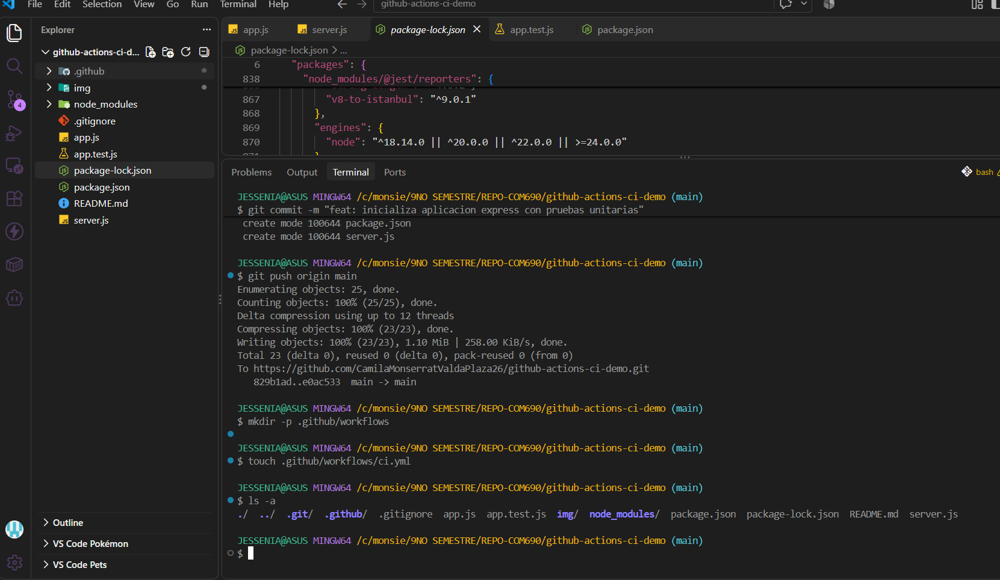

**Figura 19. Creación de la carpeta y el archivo del workflow.**
Se observa la terminal ejecutando `mkdir -p .github/workflows` para crear la estructura de carpetas y `touch .github/workflows/ci.yml` para crear el archivo vacío. GitHub solo reconoce los workflows que están dentro de `.github/workflows`, por eso se prepara esa ruta.

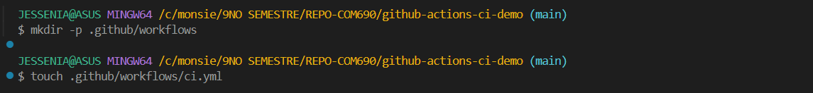

**Figura 20. Contenido inicial del workflow.**
Se observa el archivo `ci.yml` con el nombre `CI Basico`, los eventos `push` y `pull_request` limitados a la rama `main`, y el job `build-and-test` sobre `ubuntu-latest`. Los pasos son checkout con `actions/checkout@v6`, configuración de Node.js 20 con `actions/setup-node@v6`, instalación con `npm ci` y pruebas con `npm test`.

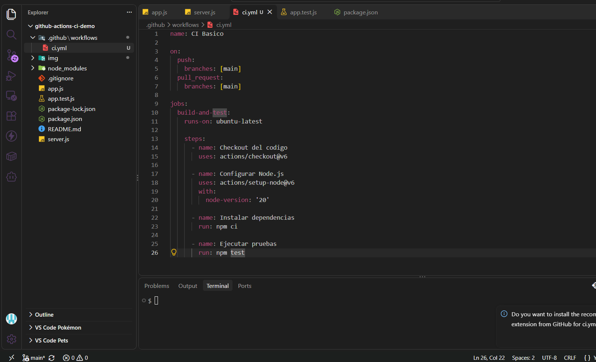

**Figura 21. Commit y push del workflow básico.**
Se observa la terminal ejecutando `git add .github/workflows/ci.yml`, el commit `22acdfa` con el mensaje «ci: agrega workflow basico de integracion continua» y el push a `main`. El commit modifica un solo archivo y agrega 26 líneas, que corresponden al workflow recién creado.

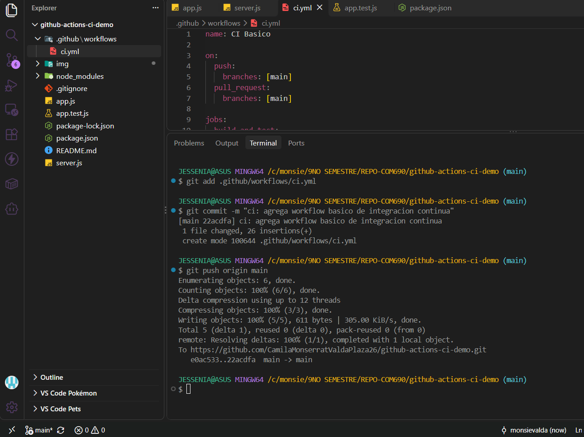

**Figura 22. Workflow visible en el repositorio.**
Se observa la página del repositorio con la carpeta `.github/workflows` y el commit `22acdfa` marcado con un check verde. Esto indica que GitHub reconoció el workflow y que la ejecución asociada a ese commit terminó correctamente.

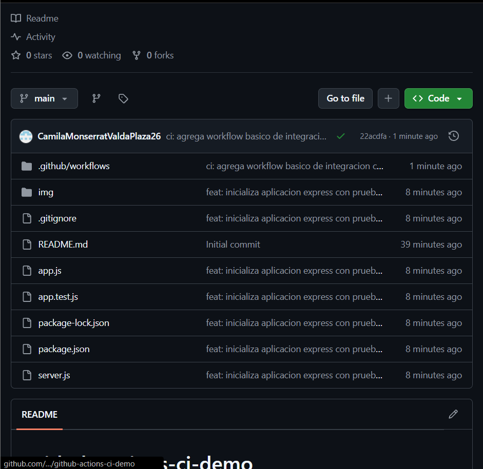

**Figura 23. Pestaña Actions con el workflow registrado.**
Se observa la pestaña Actions, en «Todos los flujos de trabajo», con el workflow `CI Básico` y su primera ejecución. La ejecución `#1` corresponde al commit `22acdfa`, está marcada en verde y tiene una duración de 17 segundos.

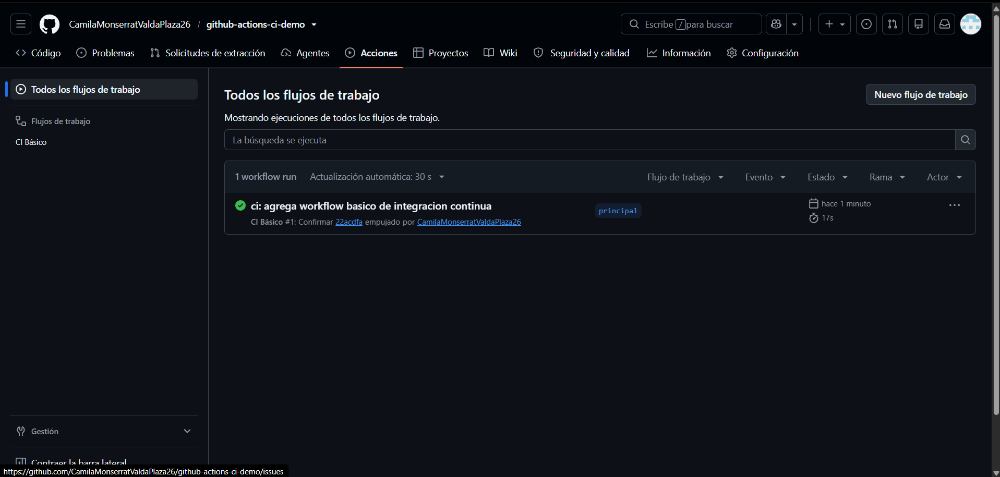

**Figura 24. Resumen de la ejecución del workflow.**
Se observa el resumen de la ejecución `#1`, donde el job `build-and-test` terminó correctamente en 14 segundos. La lista de pasos incluye la preparación del job, el checkout del código, la configuración de Node.js, la instalación de dependencias, la ejecución de pruebas, los pasos posteriores y la finalización del job.

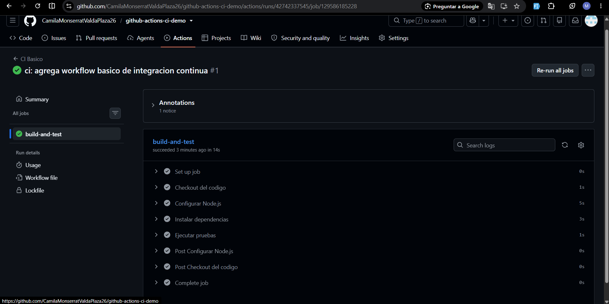

**Figura 25. Detalle del paso de preparación y checkout.**
Se observa el log del paso `Set up job`, con la versión del runner `2.338.2` y las acciones `actions/checkout@v6` y `actions/setup-node@v6` que GitHub descarga antes de ejecutar el job. También se observa el inicio del paso `Checkout del codigo`, donde se sincroniza el repositorio y se configura el directorio seguro de Git.

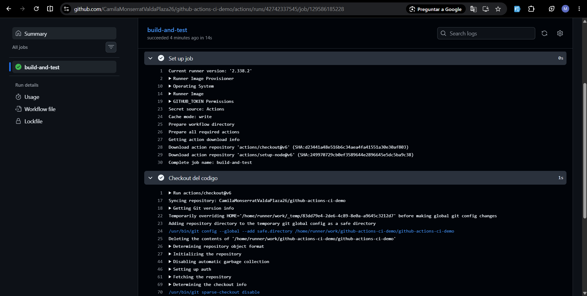

**Figura 26. Detalle de checkout, Node.js e instalación.**
Se observa el final del checkout, que confirma la referencia `22acdfa`, y el paso `Configurar Node.js`, que descarga Node.js 20.20.2, lo extrae y lo agrega a la caché. Después se observa el paso `Instalar dependencias`, donde `npm ci` agrega 361 paquetes y muestra el aviso de que `glob@10.5.0` está obsoleto.

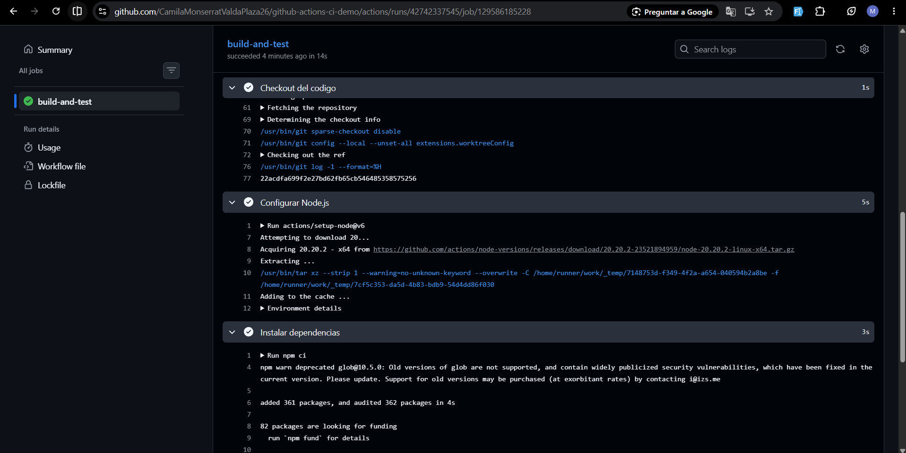

**Figura 27. Detalle de instalación y pruebas.**
Se observa el final de `npm ci`, con 19 vulnerabilidades (3 bajas y 16 moderadas) y la sugerencia de ejecutar `npm audit fix`. Luego se observa el paso `Ejecutar pruebas`, donde `npm test` ejecuta Jest, muestra `PASS ./app.test.js`, las dos pruebas aprobadas y un tiempo de 0.344 segundos.

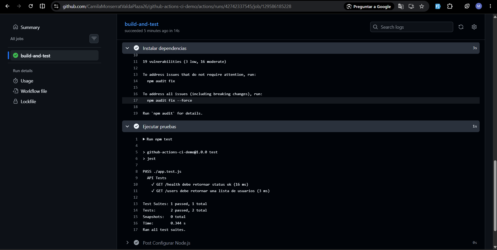

**Figura 28. Detalle de los pasos posteriores y cierre del job.**
Se observa el paso `Post Configurar Node.js`, que solo ejecuta una limpieza, y el paso `Post Checkout del codigo`, que elimina configuraciones temporales de Git, credenciales y entradas `includeIf`. Al final, `Complete job` limpia los procesos huérfanos y confirma que el job terminó correctamente.

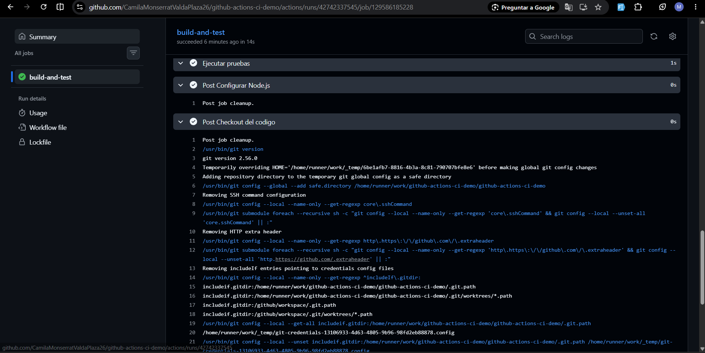

**Figura 29. Resumen de todos los jobs.**
Se observa la página de resumen de la ejecución `#1`, con el estado «Éxito», una duración total de 17 segundos y el job `build-and-test` completado en 14 segundos. El diagrama muestra el workflow `ci.yml` activado por un `push` y el job «compilar y probar» en verde.

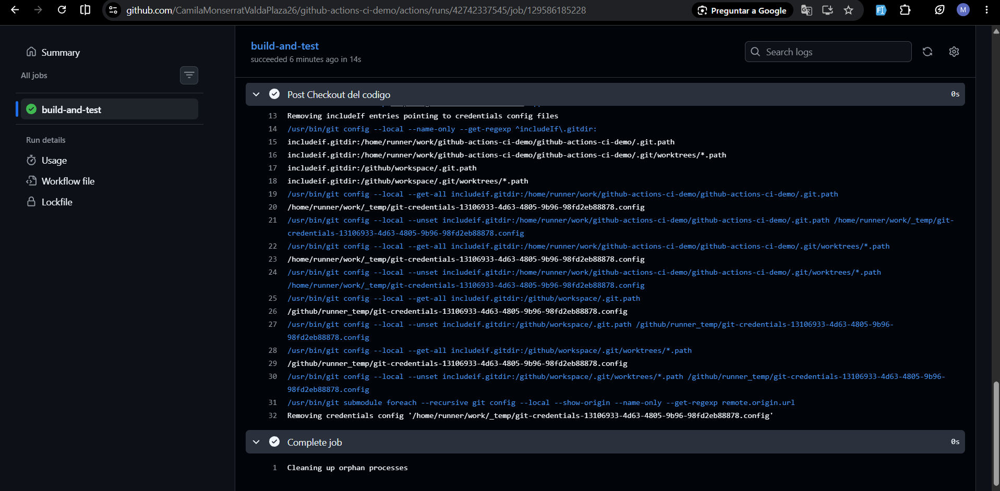

**Figura 30. Ejecución exitosa del workflow básico.**
Se observa nuevamente el resumen final de la ejecución exitosa, con el commit `22acdfa`, la rama `principal`, el estado «Éxito» y la duración total de 17 segundos. La captura sirve como confirmación visual de que el pipeline básico de integración continua quedó funcionando.

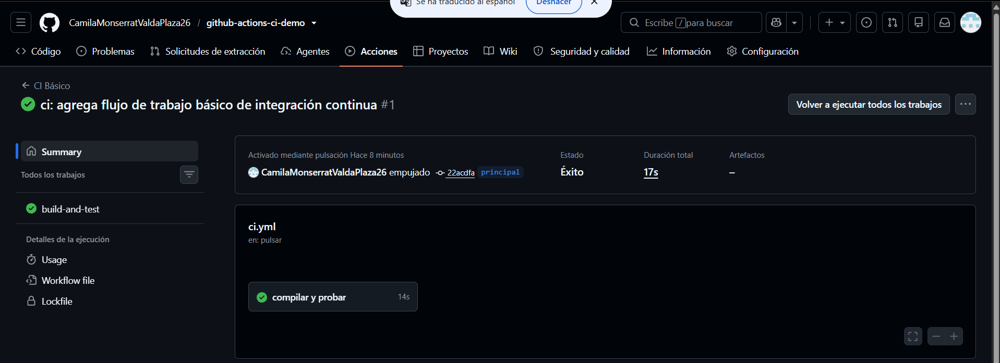

---

# Ejercicio 3.3: Extensión del pipeline con calidad de código

**Objetivo:** instalar ESLint, agregar el paso de linting al workflow y comprobar que el pipeline falla cuando se introduce un error intencional, para luego corregirlo.

Las imágenes de este ejercicio son la 31 a la 39, la 41 a la 45 y la 47 a la 49.

## Desarrollo

**Figura 31. Instalación de ESLint.**
Se observa la terminal ejecutando `npm install --save-dev eslint`, que agrega 58 paquetes y reporta 21 vulnerabilidades (3 bajas y 18 moderadas). Después se inicia `npx eslint --init`, que pregunta qué se desea analizar y se responde `javascript`.

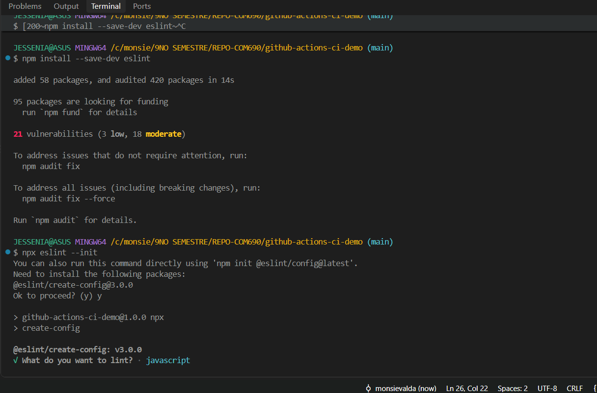

**Figura 32. Configuración interactiva de ESLint.**
Se observa el asistente `npx eslint --init` con las respuestas seleccionadas: JavaScript, uso de ESLint para encontrar problemas de sintaxis, módulos CommonJS, sin framework, sin TypeScript y código que se ejecuta en el navegador. Al final se elige npm como gestor y se crea el archivo `eslint.config.mjs`.

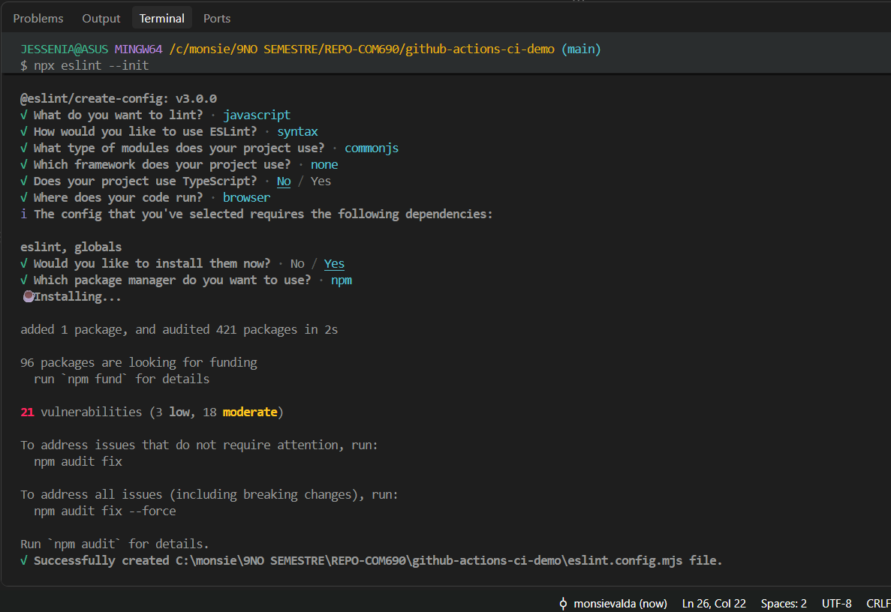

**Figura 33. Script de linting y archivo de configuración.**
Se observa el `package.json` con el script `lint` agregado (`eslint .`) y el archivo `eslint.config.mjs` en el explorador de VS Code. La terminal confirma que la configuración se creó correctamente en la ruta del proyecto, por lo que ya se puede ejecutar el análisis estático de forma local.

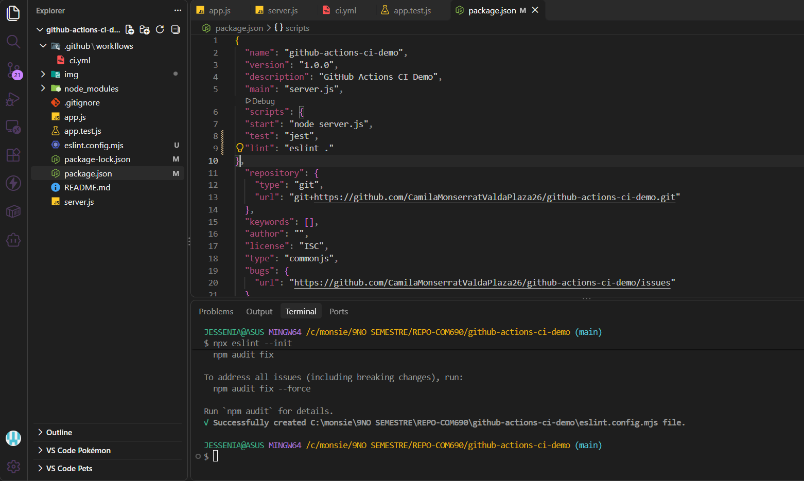

**Figura 34. Workflow actualizado con el paso de linting.**
Se observa el archivo `ci.yml` con el nombre `CI con Linting` y un nuevo paso llamado `Ejecutar linting`, que ejecuta `npm run lint` antes del paso `Ejecutar pruebas`. Con este cambio, el pipeline verifica primero el estilo y la sintaxis, y solo después ejecuta las pruebas.

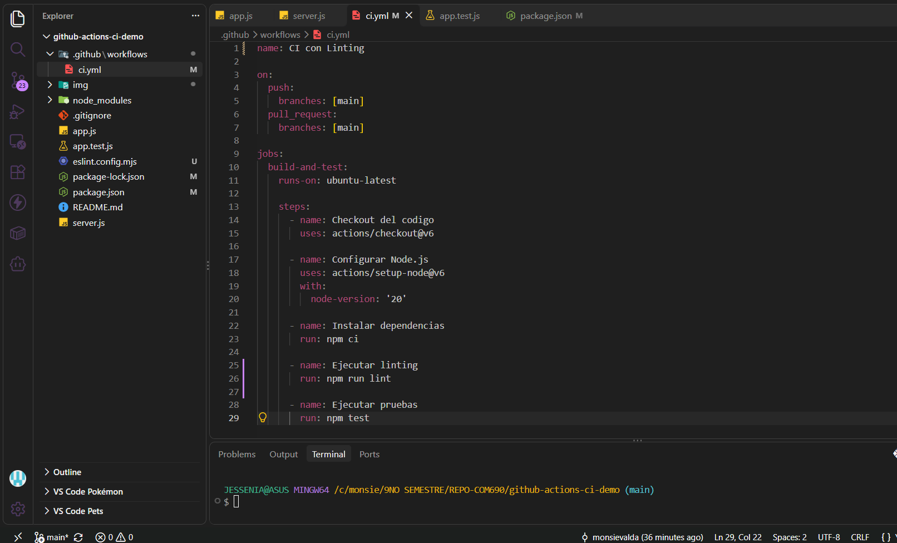

**Figura 35. Commit del paso de linting.**
Se observa la terminal ejecutando `git add .`, con avisos de fin de línea, y el commit `c9f67b1` con el mensaje «ci: agrega paso de linting al pipeline». El commit registra 24 archivos y 765 inserciones, entre ellos `eslint.config.mjs`, las imágenes `img/15.png` a `img/28.png` y el `ci.yml` actualizado.

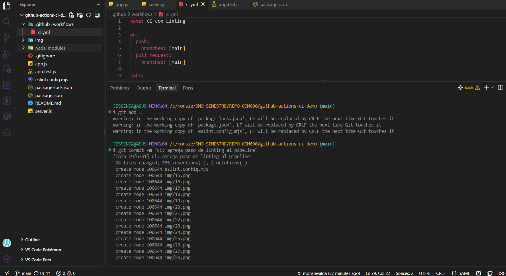

**Figura 36. Ejecución del workflow con linting.**
Se observa la pestaña Actions con el workflow `CI con Linting`. La ejecución `#2`, asociada al commit `c9f67b1`, aparece en progreso, mientras que la ejecución `#1`, del commit `22acdfa`, sigue marcada como exitosa con 17 segundos.

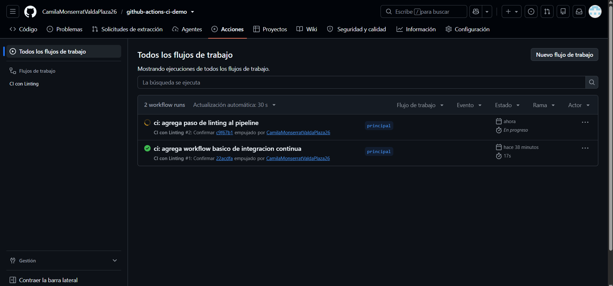

**Figura 37. Push del workflow con linting.**
Se observa el final del commit `c9f67b1`, con la creación de las imágenes `img/26.png` a `img/34.png`, y la ejecución de `git push origin main`. El push actualiza la rama `main` desde `22acdfa` hasta `c9f67b1`, por lo que GitHub vuelve a ejecutar el workflow.

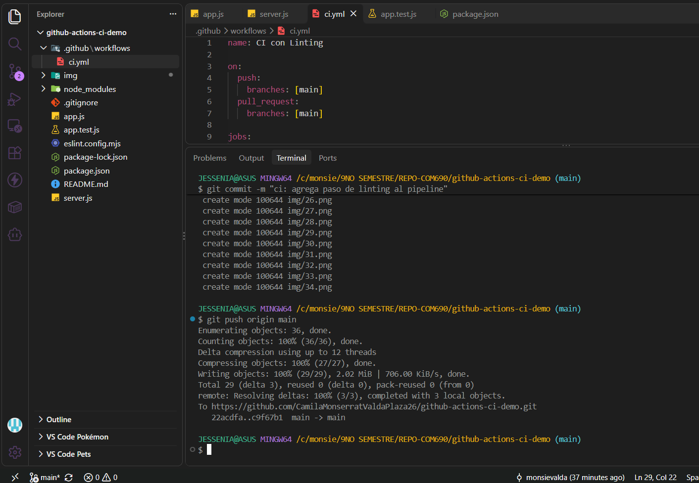

**Figura 38. Historial de ejecuciones con linting.**
Se observa la lista de ejecuciones del workflow `CI con Linting`: la ejecución `#2` del commit `c9f67b1` terminó en verde con 18 segundos y la ejecución `#1` del commit `22acdfa` terminó en verde con 17 segundos. Esto confirma que el paso de linting no rompió el pipeline.

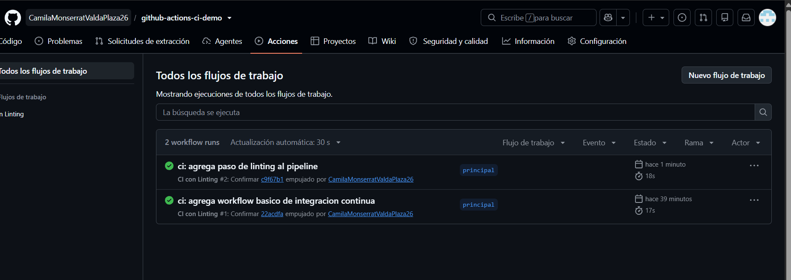

**Figura 39. Error de sintaxis intencional en app.js.**
Se observa el archivo `app.js` con una llave de cierre adicional en la línea 25, después de `module.exports = app`. La llave aparece marcada con un error de sintaxis en el editor y se agregó a propósito para comprobar que ESLint detiene el pipeline cuando el código no es válido.

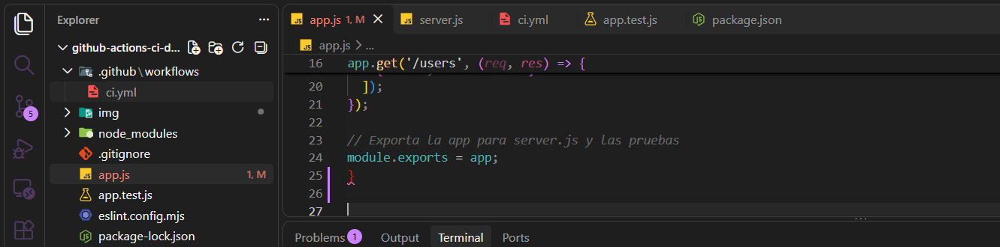

**Figura 41. Commit y push del error intencional.**
Se observa el archivo `app.js` con la llave adicional y la terminal ejecutando `git add app.js`, el commit `2f050d8` con el mensaje «test: fuerza un error de linting para probar el pipeline» y el push a `main`. El commit modifica un solo archivo y agrega dos líneas, que corresponden al error intencional.

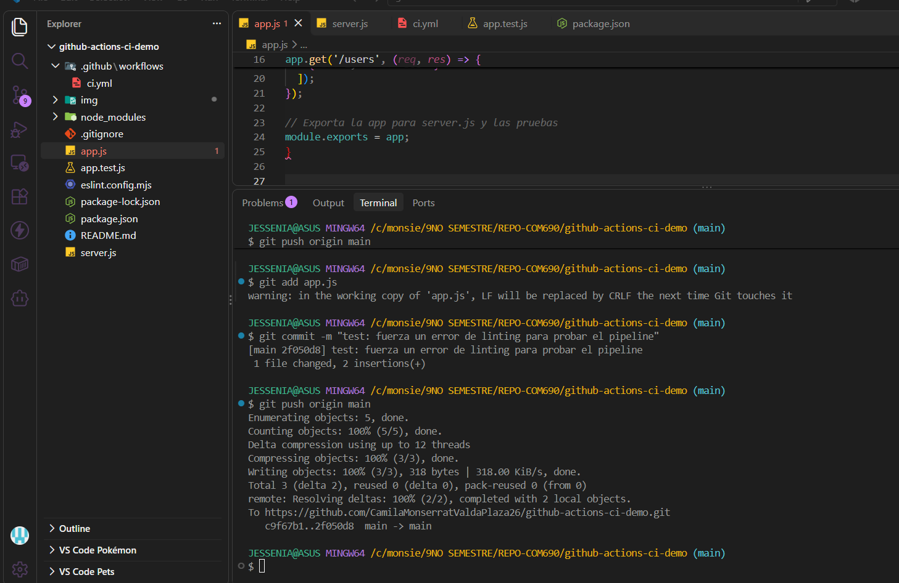

**Figura 42. Ejecución del error intencional en cola.**
Se observa la pestaña Actions con tres ejecuciones: la `#3` del commit `2f050d8` aparece en estado `Queued`, mientras que la `#2` y la `#1` siguen en verde. La ejecución en cola es la que contiene el error de sintaxis y todavía no había comenzado a correr.

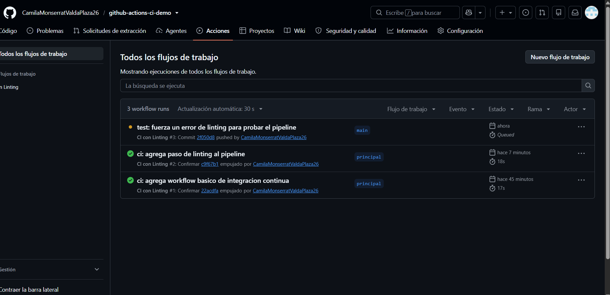

**Figura 43. Ejecución fallida del error intencional.**
Se observa la misma lista de ejecuciones, pero ahora la `#3` del commit `2f050d8` aparece marcada en rojo y terminó en 16 segundos. Las ejecuciones `#2` y `#1` continúan en verde, lo que demuestra que el fallo corresponde únicamente al cambio intencional.

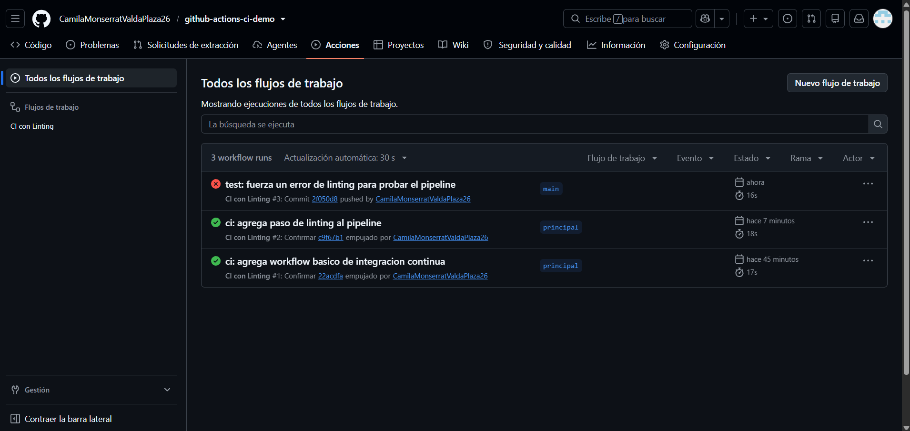

**Figura 44. Detalle del job fallido por linting.**
Se observa el job `build-and-test` fallido en 13 segundos. Los pasos de checkout, configuración de Node.js e instalación de dependencias están en verde, pero `Ejecutar linting` está en rojo: el log muestra el error `25:1 error Parsing error: Unexpected token }`, un problema de sintaxis y el mensaje `Process completed with exit code 1`. El paso de pruebas quedó omitido por el fallo anterior.

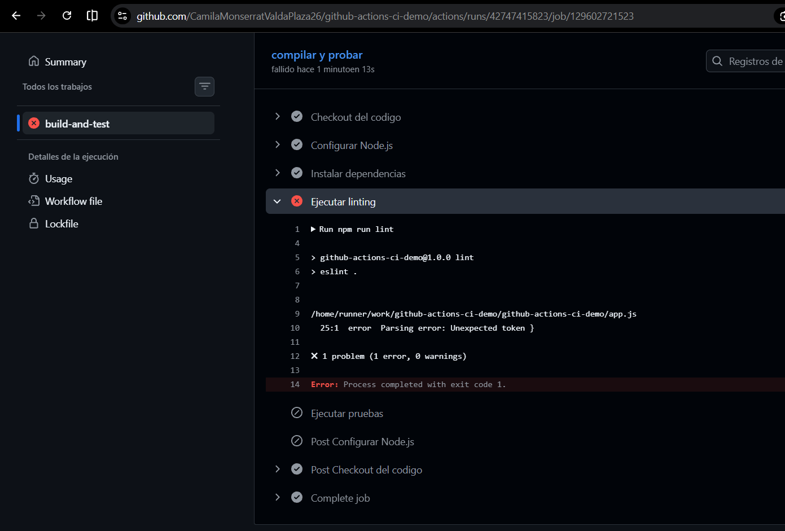

**Figura 45. Corrección en progreso.**
Se observa la pestaña Actions con cuatro ejecuciones: la `#4` del commit `27fa8fe` con el mensaje «fix: corrige error de sintaxis intencional» aparece en progreso, la `#3` del commit `2f050d8` sigue en rojo y las ejecuciones `#2` y `#1` siguen en verde. La corrección se estaba ejecutando en ese momento.

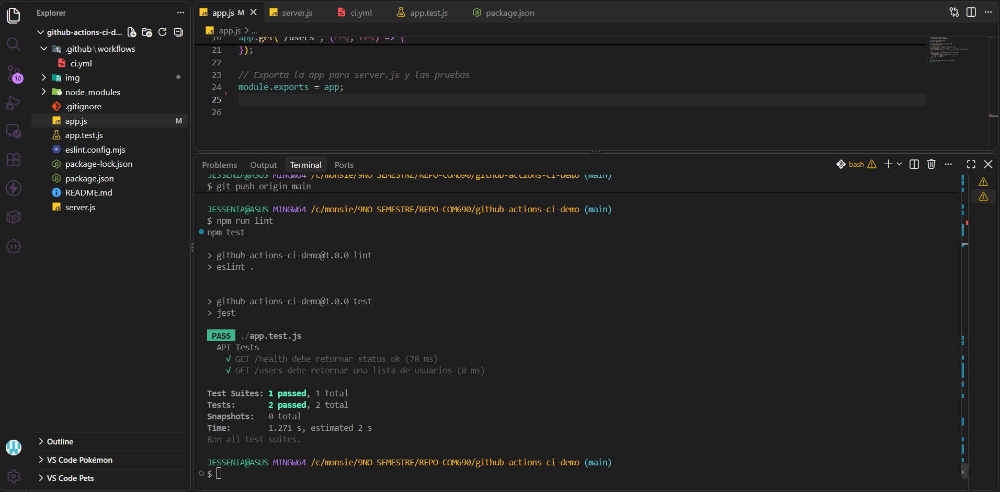

**Figura 47. Historial con la corrección exitosa.**
Se observa la lista de ejecuciones con la `#4` del commit `27fa8fe` ya en verde y con una duración de 28 segundos. La `#3` del error intencional permanece en rojo, mientras que las ejecuciones `#2` y `#1` siguen en verde, lo que confirma que la corrección resolvió el problema.

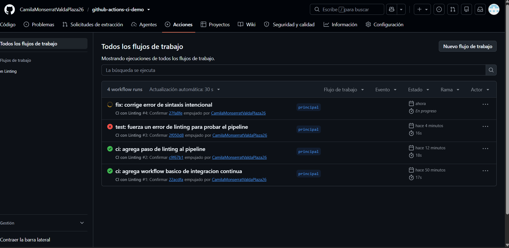

**Figura 48. Historial final de la corrección.**
Se observa nuevamente el historial de ejecuciones con la `#4` en verde, la `#3` en rojo y las ejecuciones anteriores en verde. La captura refuerza la secuencia completa: pipeline básico exitoso, linting exitoso, error intencional fallido y corrección exitosa.

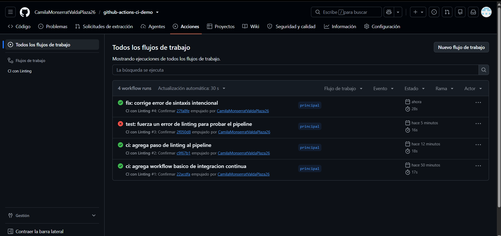

**Figura 49. Verificación, commit y push de la corrección.**
Se observa el archivo `app.js` sin la llave adicional y la terminal ejecutando `npm run lint` y `npm test`; ambas comprobaciones pasan y Jest muestra las dos pruebas aprobadas. Después se ejecuta `git add app.js`, el commit `27fa8fe` con el mensaje «fix: corrige error de sintaxis intencional» y el push a `main`.

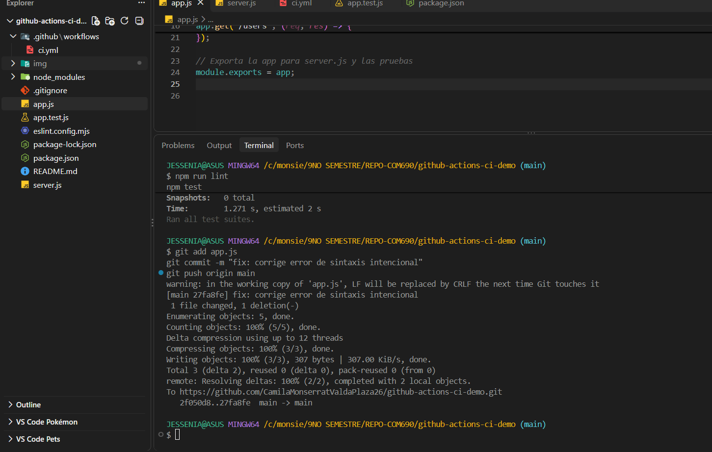

---

# Ejercicio 3.4: Uso de matrices de ejecución

**Objetivo:** modificar el workflow para ejecutar el mismo job en paralelo con dos versiones de Node.js y verificar los dos jobs en la pestaña Actions.

Las imágenes de este ejercicio son la 50 a la 54.

## Desarrollo

**Figura 50. Workflow con matriz de versiones.**
Se observa el archivo `ci.yml` con el nombre `CI con Matriz`, la variable `FORCE_JAVASCRIPT_ACTIONS_TO_NODE24` y la estrategia `matrix` con `node-version: [20, 22]`. El paso de configuración usa `${{ matrix.node-version }}` para que cada job instale su propia versión de Node.js, y se mantienen los pasos de instalación, linting y pruebas.

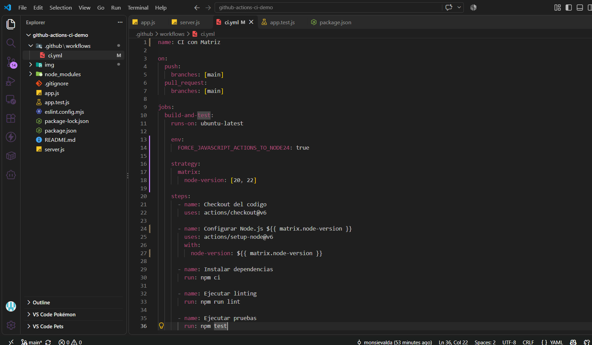

**Figura 51. Matriz en cola.**
Se observa la pestaña Actions con cinco ejecuciones: la `#5` del commit `6c550ad` con el mensaje «ci: agrega matriz de versiones de node.js» aparece en estado `Queued`. Las ejecuciones anteriores (`#4`, `#3`, `#2` y `#1`) muestran la corrección exitosa, el error intencional fallido y las ejecuciones previas en verde.

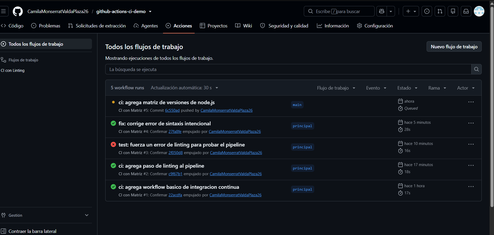

**Figura 52. Matriz finalizada en el historial.**
Se observa la lista de ejecuciones con la `#5` del commit `6c550ad` ya en verde y con una duración de 18 segundos. Las ejecuciones `#4`, `#3`, `#2` y `#1` conservan sus estados, por lo que el historial completo queda como evidencia del proceso.

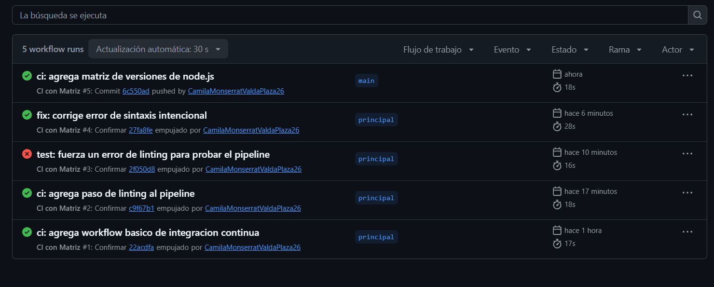

**Figura 53. Resumen de la matriz con dos jobs.**
Se observa el resumen de la ejecución `#5`, con el estado «Éxito» y una duración total de 18 segundos. En la barra lateral aparecen los dos jobs de la matriz, `build-and-test (20)` y `build-and-test (22)`, ambos en verde, y el diagrama indica «2 trabajos completados».

**Figura 54. Resultado final de la matriz.**
Se observa el detalle final de la ejecución `#5`, donde la matriz muestra el job `build-and-test (20)` con 14 segundos y el job `build-and-test (22)` con 11 segundos. Ambos trabajos terminaron correctamente y las anotaciones recuerdan la migración de `ubuntu-latest`, lo que confirma que el mismo pipeline se ejecutó en paralelo con dos versiones de Node.js.

---

# Conclusiones

La integración continua permitió comprobar, de forma automática, que la aplicación se instala, se analiza y se prueba correctamente cada vez que se sube un cambio. El pipeline comenzó con un único paso de pruebas y fue creciendo hasta incluir el linting y una matriz de versiones de Node.js, lo que demuestra que un workflow puede adaptarse a medida que el proyecto lo necesita.

El fallo intencional fue especialmente útil: al introducir una llave adicional en `app.js`, ESLint detuvo el pipeline y GitHub mostró el error exacto con el archivo y la línea. Después de corregir el código, el workflow volvió a pasar, lo que confirma que el pipeline no solo informa el error, sino que también verifica la corrección.

La matriz de ejecución mostró otra ventaja de CI: el mismo conjunto de pruebas se ejecutó en paralelo con Node.js 20 y Node.js 22, sin duplicar trabajo manual. Esto ayuda a detectar incompatibilidades entre versiones antes de que el código llegue a producción.

En conjunto, el laboratorio demuestra que GitHub Actions permite automatizar la calidad del código con poco esfuerzo de configuración y que las capturas de cada etapa sirven como evidencia de que el pipeline funcionó de principio a fin.
